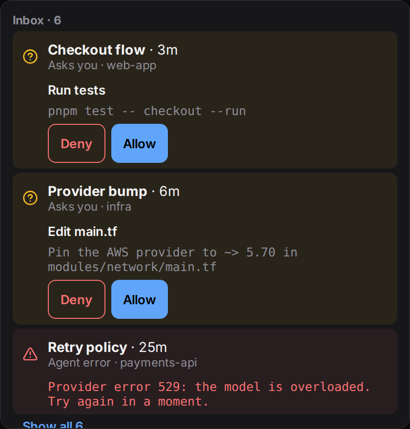
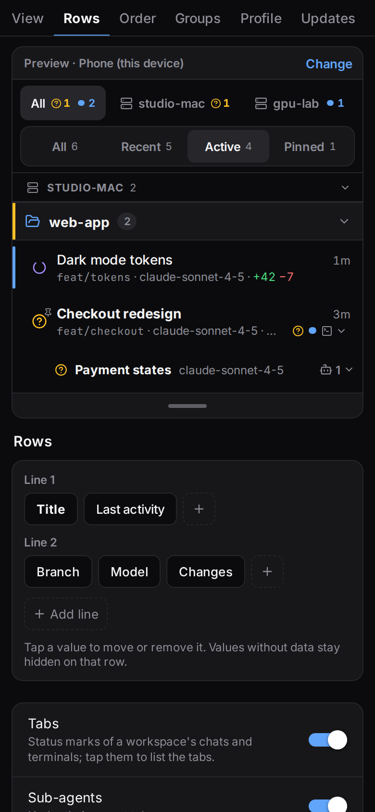
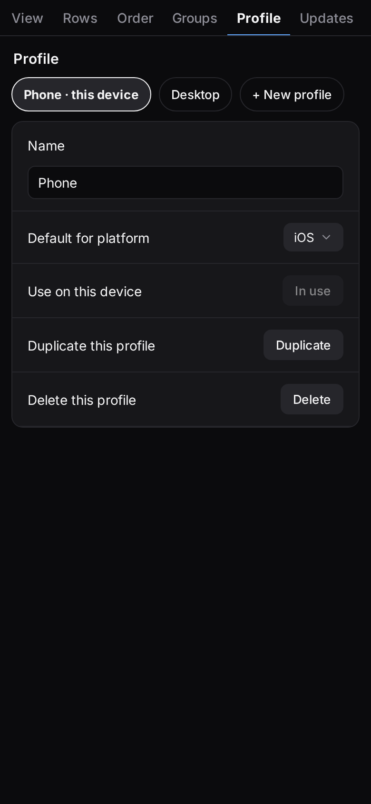
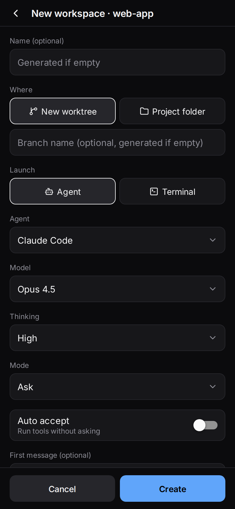

# Workspace Organizer for Paseo

A Host → Project → Workspace tree for [Paseo](https://paseo.sh) on the phone, desktop and web. It shows every workspace on every connected host in one place, with an Inbox of what needs you. Formerly "Phone Navigator".

<p>
  
  
  
</p>

## Features

- **One tree for all hosts, or one host at a time.** With more than one host, pick *All* or a single host from tabs above the list or from a host button in the title bar (a profile setting); each shows what waits there. *All* separates hosts with a thin divider; a single host shows only its projects. Projects and workspaces can be collapsed, and the tree remembers what you collapsed. Offline hosts are shown dimmed. Folded groups count what asks you, failed or is unread.
- **Inbox.** The title bar shows how many chats wait for you, how many ask you and how many failed. Tapping it opens the Inbox: one entry per top-level chat (sub-agents left out) that asks you, failed or is unread, on every host (hidden hosts too), questions and errors first. An entry opens that chat; "Mark N unread as read" can be undone. An asking chat shows what it asks, and you can answer right there: allow or deny a permission (or use the provider's own buttons) and pick an answer to single-choice questions. A failed chat shows its last error. Hosts that are offline, loading or failing to load are named; "All caught up" only shows when every host was checked.
- **Read state per chat.** A chat stays unread until you mark it read, type in it or send it a prompt. Opening it alone does not mark it read: the plugin remembers Paseo's news flag. Typing means the cursor in the message field on web and desktop, or the keyboard opening while the chat is on screen on phones. Press **Mark read** in the chat header to mark it read, or **Mark unread** to put it back in the Inbox. Questions and errors stay until you answer or fix them. Read state is synced across devices.
- **Composer pills.** Under each chat's message field: **Inbox** with the count of what waits, which opens the Inbox with Back and Forward; **Mark read** on an unread chat or **Mark unread** on a read one, which marks it and opens the next chat in the Inbox; and **Catch up**.
- **Catch-up.** Press **Catch up** under a chat to see where it left off and what comes next, in two lines of at most 80 characters each. A small model you choose (Settings → Inbox) writes it on the chat's host; it is stored on the chat, so the Inbox and every device show it too. By default it also gives the chat a short topic name instead of the start of your first prompt; names you chose yourself stay, and a switch turns renaming off.
- **Inbox lines.** Each profile lays out the Inbox entries in one to three lines, like workspace rows: chat, catch-up, workspace, project, host, waiting since, state, model, branch. The workspace title is left out when it only repeats the chat's.
- **Back and forward.** Step through the chats you visited with the Inbox pill's Back and Forward, or on web and desktop with Alt+← / Alt+→ and the mouse's back and forward buttons.
- **Workspace rows.** Each row shows a status glyph (a shape per status, not only a colour) and one to three lines you lay out per profile: title, last activity, branch, model, changes, why it needs you ("Asks you · Payment states", from top-level chats only, like the Inbox), project and host, each on the line and in the order you choose. On the right: one mark per tab. Tap the marks to list the tabs (chats and terminals); a chat with sub-agents folds them under it. On phones rows grow with the system text size.
- **Views and search.** All, Recent, Active (running, unread or asking you) and Pinned, each with a count. Pinned workspaces show in Pinned and All only. Search covers titles, branches, projects, hosts, models and tab titles; a row found through a tab says which.
- **Actions.** Hold a row (or use ⋯ / right-click on desktop) for pin, mark read, remove from Recent, rename, move and archive; holding a tab adds "Mark … read" for it. On phones, swipe a row left for *Mark read* (marks its unread chats read) or right to remove it from Recent (or put it back); both can be undone. A workspace removed from Recent comes back when you send it a prompt, or while it asks you or failed. Holding a project's name opens its sheet (new workspace, move, folder colour). Archiving keeps the row dimmed until the host has archived it.
- **Colours.** Hold (or right-click) a project's folder icon, a host's icon or a host tab to give it a colour. On desktop, the profile sets how the open workspace is marked (bar, tinted row, outline or none) and in which colour; phones never mark it. Colours sync to every profile, device and host.
- **New workspace.** The **+** on a project row opens a draft, like Paseo's own New workspace screen: choose a new worktree (optional branch name) or the project folder, then an agent with model, mode, the agent's on/off options such as *Auto Accept*, and a first message, or a terminal. Nothing is created until you tap *Create*.
- **New project.** The folder-plus in the title bar adds an existing folder on that host as a project (`~` works) and opens a workspace on it. Plugins cannot create folders, so the folder must exist.
- **Stable order.** Projects and workspaces are sorted by when you last prompted them (or created them), newest first. Agent output and status never move a row; the Inbox and the marks show what needs you. For your own order, set a profile's *Order* to *Manual*, then drag rows by their grip. On phones, Options → *Arrange order…* shows the grips. Projects reorder within their host and workspaces within their project.
- **Profiles.** Phone and Desktop come built in, and you can add your own. A profile holds the density, how you pick the host, the view it opens on, what Recent means, the row lines, order, pins, hidden hosts and the collapse state. The settings screen shows a live preview above the settings (every tab but Profile) that follows each change: host switch, opening view, row lines, open marker, hidden hosts, order grips, folding defaults. It uses sample workspaces on your host names and stays in place while the settings scroll.
- **Entry points.** A "Workspaces" row in the sidebar, a sidebar view (Paseo 0.16), header buttons on every workspace (Workspaces, then Mark read), pills under each chat's message field, and a Command Center entry.

| Desktop sidebar | Inbox pill popover | Search | Row actions |
| --- | --- | --- | --- |
|  |  |  |  |
| All hosts under thin dividers; the open workspace marked with a bar | Back and Forward, then the Inbox with its answers | Matches across hosts, named under each row | Details card on top, then pin, mark read, Recent, rename, archive |

| Settings: Rows | Settings: Profile | New workspace | Sidebar row |
| --- | --- | --- | --- |
|  |  |  |  |
| Line editor under the live preview | Built-in and own profiles, per platform and device | Worktree or folder, agent, model, thinking, mode, options | "Workspaces" with the Inbox counts |

See [OVERVIEW.md](OVERVIEW.md) for more detail.

## Install

Requires Paseo 0.15 or later, and `git` on the daemon host must be able to clone from GitHub.

```bash
paseo plugin install git:tliser/paseo-workspace-organizer
paseo plugin ls                           # workspace-organizer should be "running"
paseo plugin logs workspace-organizer     # "Plugin ready"
```

Then open the sidebar on any client and tap **Workspaces**. Profiles are set up on their own settings screen: Options → *Settings…* in the tree, or **Open** under Settings → Plugins → Workspace Organizer.

To update, run the install command again (or `paseo plugin reload workspace-organizer` for a local checkout).

### Tips

- On the phone the header button may sit behind the "⋯" menu, because Paseo shows only one plugin button inline on narrow screens. The sidebar row always works.
- Phones cannot tell which field the keyboard is for, so the keyboard marks the chat read only while none of the plugin's own fields or screens is in use.
- Drag only works when the active profile's *Order* is *Manual* and the search box is empty.

## Privacy

The plugin works only through the app's existing host connections. It reads workspace and agent metadata, not conversations, and changes workspaces only when you ask it to (create, rename, archive, add a project, answer a permission or question). It does not contact any outside service, except GitHub through `paseo plugin update` when automatic updates are on.

## Development

```bash
npm install
npm run typecheck
npm test
paseo plugin install /path/to/checkout     # local install
paseo plugin reload workspace-organizer     # after changes
```

Layout:

- `index.client.tsx` / `index.server.ts`: plugin entry points (screens, sidebar item, header button, command, settings).
- `shared/`: pure logic with tests.
  - `tree.ts`: builds, sorts and filters the flattened tree.
  - `profiles.ts`: profiles, resolution, the collapse map.
  - `order.ts`: manual order.
  - `drag.ts`: row geometry and drop targets.
  - `reads.ts`: read/unread state and remembered news.
  - `inbox.ts`: the Inbox entries and host notes.
  - `derive.ts`: daemon payloads to rows.
  - `format.ts`: model names and times.
- `client/host-observer.ts`: follows one host (paged snapshot, buffered live updates, reconnect-safe).
- `client/store.ts`: one store for every surface. It watches all online hosts and persists profiles, order, reads and collapse state.
- `client/navigator-screen.tsx`, `client/drag-controller.ts`: the tree screen and long-press drag.
- `client/settings-screen.tsx`, `client/sidebar-item.tsx`, `client/header-buttons.tsx`: the other surfaces.
- `client/composer-pills.tsx`, `client/chat-nav.ts`, `client/chat-input.ts`: pills under the message field, visited-chat history, typing marks read.
- `client/go-screen.tsx`: opens a chat from a composer pill when the sidebar view is not shown.
- `client/device.ts`: the only file that touches `localStorage` (web and desktop only).
- `client/paseo.ts`: SDK types derived from `getPaseoClient`, so a Git install compiles without dev dependencies.
- `mockups/index.html`: the original clickable design mockup.

There are no classes anywhere, because the mobile apps run plugins on Hermes.

## License

MIT, see [LICENSE](LICENSE).
