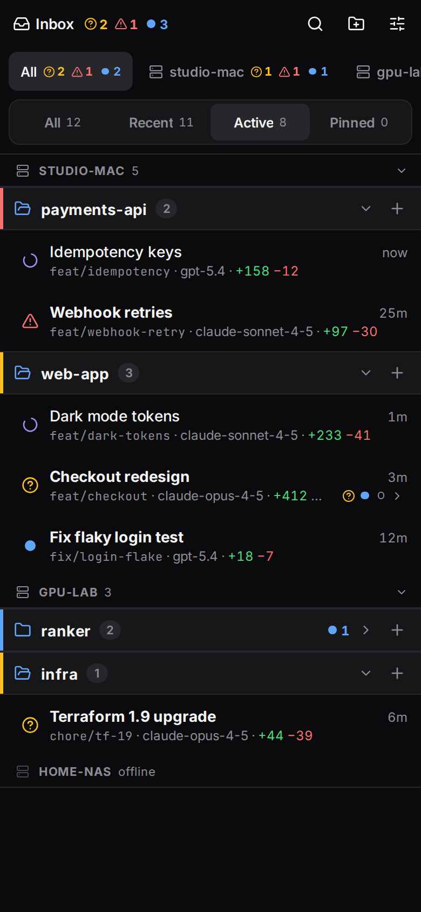
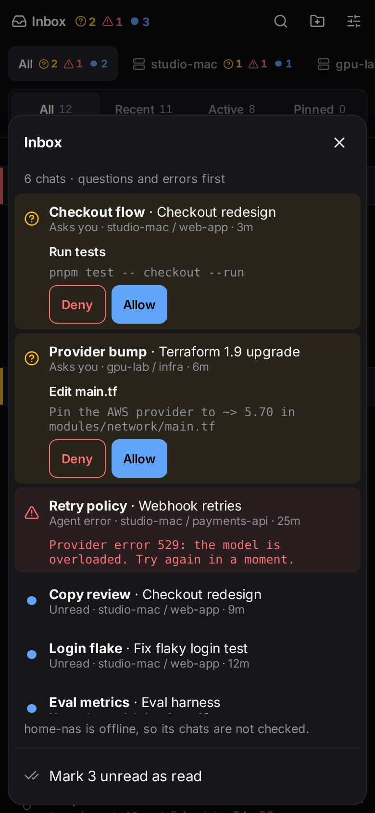
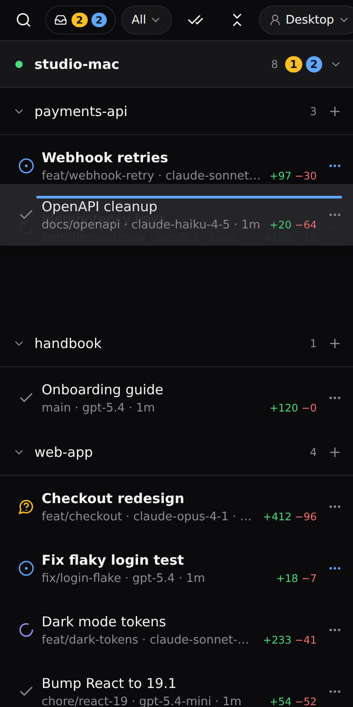
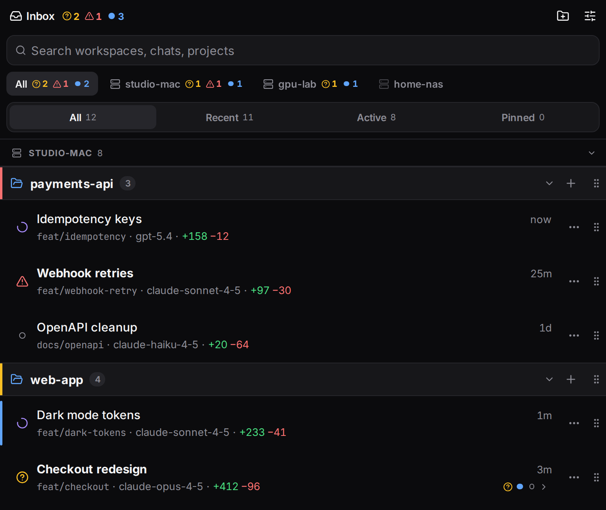
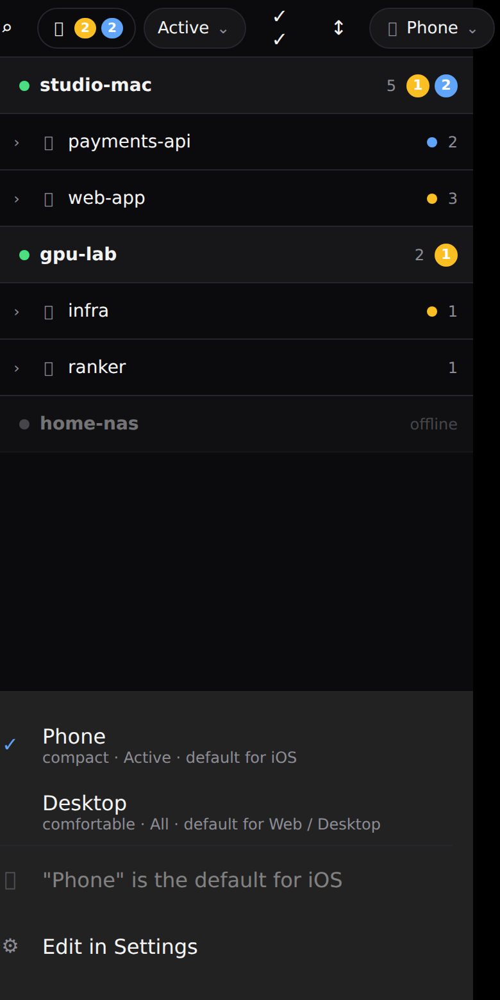
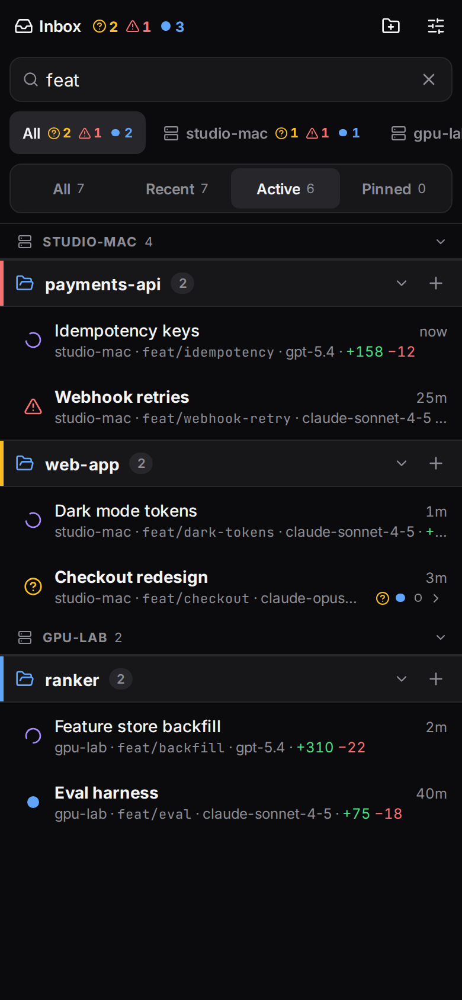
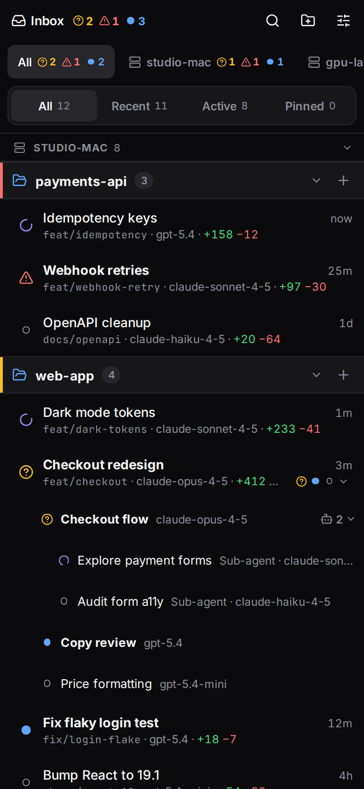
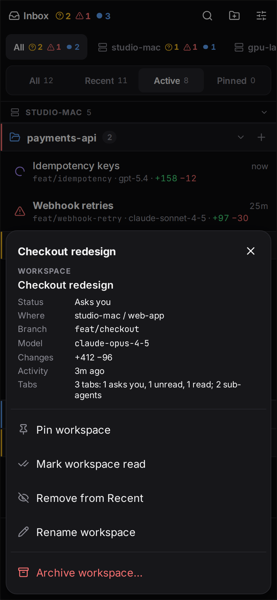

# Workspace Organizer for Paseo

A Host → Project → Workspace tree for [Paseo](https://paseo.sh) on the phone, desktop and web. It shows every workspace on every connected host in one place, with an Inbox of what needs you. Formerly "Phone Navigator".

<p>
  
  
  
</p>

## Features

- **One tree for all hosts, or one host at a time.** With more than one host, pick *All* or a single host from tabs above the list or from a host button in the title bar (a profile setting); each shows what waits there. *All* separates hosts with a thin divider; a single host shows only its projects. Projects and workspaces can be collapsed, and the tree remembers what you collapsed. Offline hosts are shown dimmed. Folded groups count what asks you, failed or is unread.
- **Inbox.** The title bar shows how many chats wait for you, how many ask you and how many failed. Tapping it opens the Inbox: one entry per chat that asks you, failed or is unread, on every host (hidden hosts too), questions and errors first. An entry opens that chat; "Mark N unread as read" can be undone.
- **Read state per chat.** Opening a chat does not mark it read. Press **Done** in the chat header to mark it read, or **Put back in Inbox** to make it unread again. Questions and errors stay until you answer or fix them. Read state is synced across devices.
- **Workspace rows.** Each row shows a status glyph (a shape per status, not only a colour) and one to three lines you lay out per profile: title, last activity, branch, model, changes, why it needs you ("Asks you · Payment states"), project and host, each on the line and in the order you choose. On the right: one mark per tab. Tap the marks to list the tabs (chats and terminals); a chat with sub-agents folds them under it.
- **Views and search.** All, Recent, Active and Pinned, each with a count. Search covers titles, branches, projects, hosts, models and tab titles; a row found through a tab says which.
- **Actions.** Hold a row (or use ⋯ / right-click on desktop) for pin, mark read, remove from Recent, rename, move and archive; holding a tab adds "Mark … read" for it. On phones, swipe a row left for *Done* (marks its unread chats read) or right to remove it from Recent (or put it back); both can be undone. A workspace removed from Recent comes back when you send it a prompt, or while it asks you or failed. Holding a project's name opens its sheet (new workspace, move, folder colour). Archiving keeps the row dimmed until the host has archived it.
- **Colours.** Hold (or right-click) a project's folder icon, a host's icon or a host tab to give it a colour. Colours sync to every profile, device and host.
- **New workspace.** The **+** on a project row opens a draft, like Paseo's own New workspace screen: choose a new worktree (optional branch name) or the project folder, then an agent with model, mode, the agent's on/off options such as *Auto Accept*, and a first message, or a terminal. Nothing is created until you tap *Create*.
- **New project.** The folder-plus on a host divider (or Options → *New project on …* when one host is shown) adds an existing folder on that host as a project (`~` works) and opens a workspace on it. Plugins cannot create folders, so the folder must exist.
- **Stable order.** Projects and workspaces are sorted by when you last prompted them (or created them), newest first. Agent output and status never move a row; the Inbox and the marks show what needs you. For your own order, set a profile's *Order* to *Manual*, then drag rows by their grip. On phones, Options → *Arrange order…* shows the grips. Projects reorder within their host and workspaces within their project.
- **Profiles.** Phone and Desktop come built in, and you can add your own. A profile holds the density, how you pick the host, the view it opens on, what Recent means, the row lines, order, pins, hidden hosts and the collapse state. The row settings preview sample rows with the lines you set.
- **Entry points.** A "Workspaces" row in the sidebar, a sidebar view (Paseo 0.16), header buttons on every workspace (Done and Workspaces), and a Command Center entry.

The screenshots below show the previous version.

| Desktop | Settings | Profiles | Search |
| --- | --- | --- | --- |
|  |  |  |  |

| All, with a pin | Row actions | New workspace |
| --- | --- | --- |
|  |  |  |

See [OVERVIEW.md](OVERVIEW.md) for more detail.

## Install

Requires Paseo 0.15 or later, and `git` on the daemon host must be able to clone from GitHub.

```bash
paseo plugin install git:tliser/paseo-workspace-organizer
paseo plugin ls                           # workspace-organizer should be "running"
paseo plugin logs workspace-organizer     # "Plugin ready"
```

Then open the sidebar on any client and tap **Workspaces**. You can configure profiles under **Settings → Plugins → Workspace Organizer**.

To update, run the install command again (or `paseo plugin reload workspace-organizer` for a local checkout).

### Tips

- On the phone the header button may sit behind the "⋯" menu, because Paseo shows only one plugin button inline on narrow screens. The sidebar row always works.
- Drag only works when the active profile's *Order* is *Manual* and the search box is empty.

## Privacy

The plugin works only through the app's existing host connections. It reads workspace and agent metadata, not conversations, and changes workspaces only when you ask it to (create, rename, archive, add a project). It does not contact any outside service, except GitHub through `paseo plugin update` when automatic updates are on.

## Development

```bash
npm install
npm run typecheck
npm test
paseo plugin install /path/to/checkout     # local install
paseo plugin reload workspace-organizer     # after changes
```

Layout:

- `index.client.tsx` / `index.server.ts`: plugin entry points (screens, sidebar item, header button, command, settings).
- `shared/`: pure logic with tests.
  - `tree.ts`: builds, sorts and filters the flattened tree.
  - `profiles.ts`: profiles, resolution, the collapse map.
  - `order.ts`: manual order.
  - `drag.ts`: row geometry and drop targets.
  - `reads.ts`: read/unread state.
  - `derive.ts`: daemon payloads to rows.
  - `format.ts`: model names and times.
- `client/host-observer.ts`: follows one host (paged snapshot, buffered live updates, reconnect-safe).
- `client/store.ts`: one store for every surface. It watches all online hosts and persists profiles, order, reads and collapse state.
- `client/navigator-screen.tsx`, `client/drag-controller.ts`: the tree screen and long-press drag.
- `client/settings-screen.tsx`, `client/profile-sheet.tsx`, `client/sidebar-item.tsx`, `client/header-buttons.tsx`: the other surfaces.
- `client/device.ts`: the only file that touches `localStorage` (web and desktop only).
- `client/paseo.ts`: SDK types derived from `getPaseoClient`, so a Git install compiles without dev dependencies.
- `mockups/index.html`: the original clickable design mockup.

There are no classes anywhere, because the mobile apps run plugins on Hermes.

## License

MIT, see [LICENSE](LICENSE).
