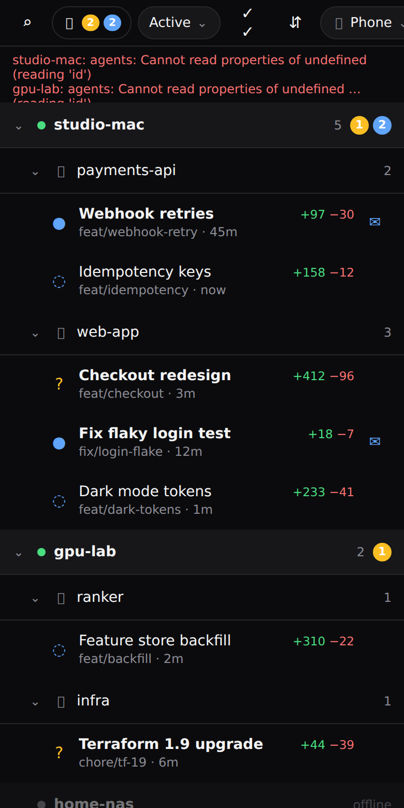
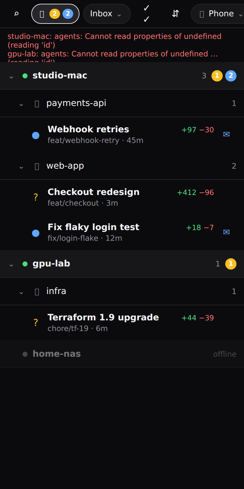
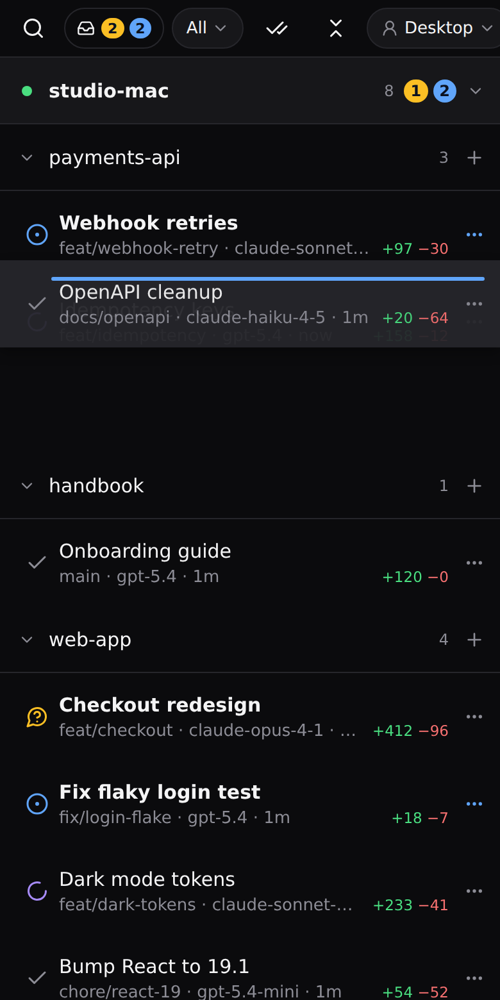
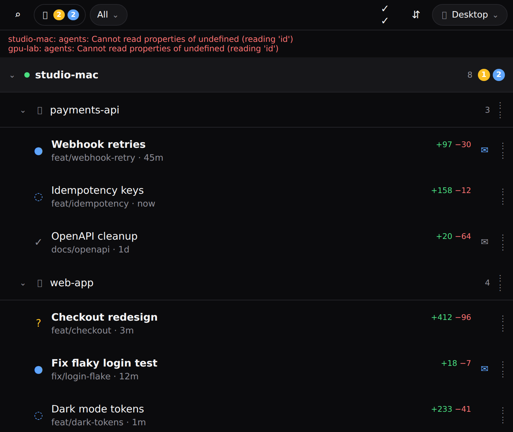
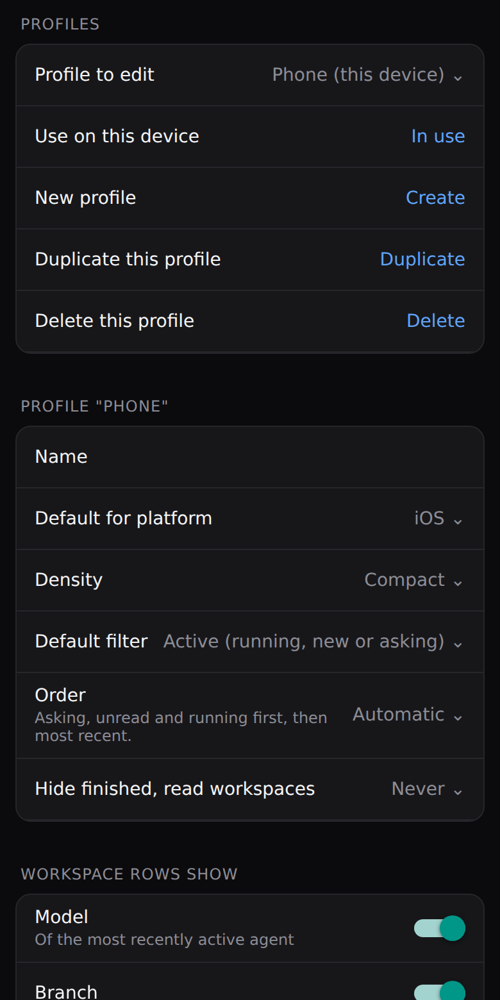
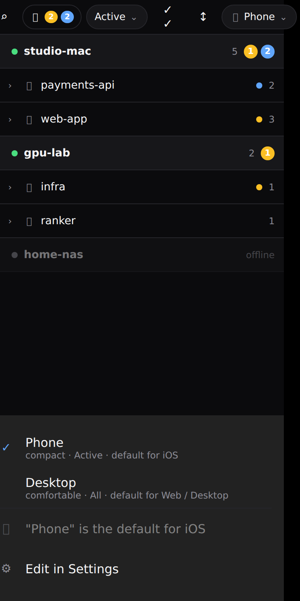
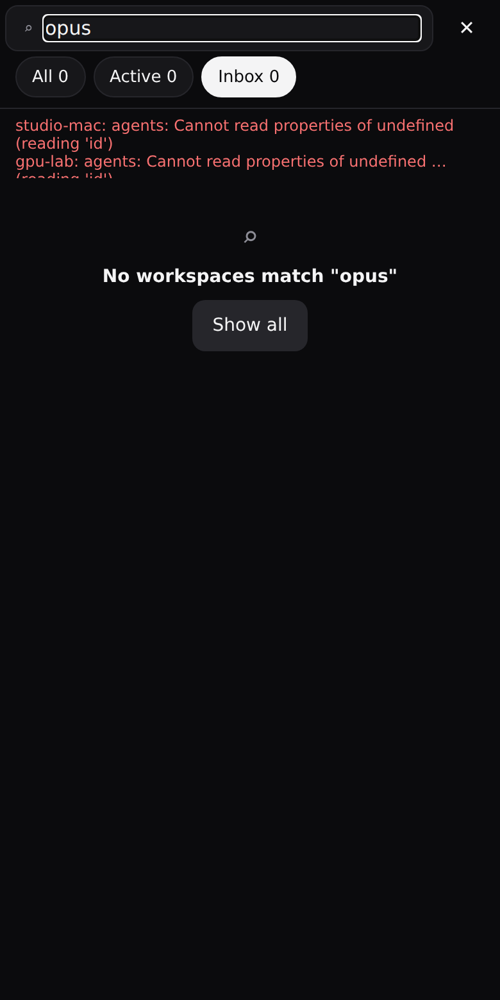
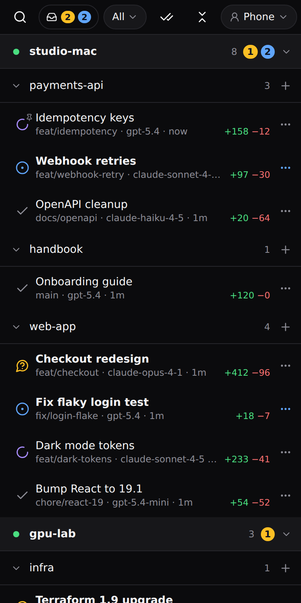
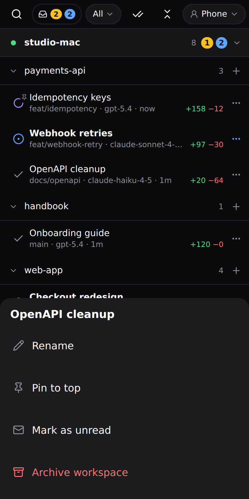
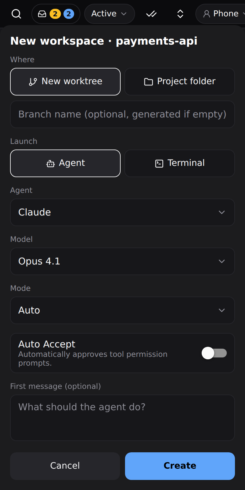

# Phone Navigator for Paseo

A Host → Project → Workspace tree for [Paseo](https://paseo.sh), built for the mobile apps but usable on desktop and web too. It shows every workspace on every connected host in one place, with what needs you on top.

<p>
  
  
  
</p>

## Features

- **One tree for all hosts.** Hosts, projects and workspaces can each be collapsed, and the tree remembers what you collapsed. Offline hosts are shown dimmed.
- **Rich workspace rows.** Each row shows the status, title, diff size, branch, the model of the most recently active agent and when it was last active.
- **Asking you vs. unread.** Workspaces that wait for input, failed or are flagged count as *asking you*. Finished work you haven't looked at yet counts as *unread*. Read state is synced across devices.
- **Filters and search.** All, Recent (active in the last 2 days by default, plus anything running, new or asking; the number of days is a profile setting), Active and Inbox (asking you plus unread), and a search box. Tap the counter badge to jump to the Inbox.
- **New workspace.** The **+** on a project row opens a draft, like Paseo's own New workspace screen: choose a new worktree (optional branch name) or the project folder, then an agent with model, mode, the agent's on/off options such as *Auto Accept*, and a first message, or a terminal. While the host is still finding its agents, the draft shows a spinner and lists the ones already ready. Nothing is created until you tap *Create*; closing the draft discards it.
- **Row actions.** The **⋯** on a workspace row renames it, pins it, marks it read or unread, or archives it. Archiving asks first and warns when an agent is still working or waiting for you.
- **Pins.** A pinned workspace stays at the top of its project in every view and is never hidden by a filter. Pins are part of the profile, so every device using it shows them.
- **Manual order.** Set a profile's *Order* to *Manual*, then long-press a row and drag it. Projects reorder within their host and workspaces within their project. Each profile keeps its own order, and new items appear first.
- **Profiles.** Phone and Desktop come built in, and you can add your own. A profile holds the density, default filter, what Recent means, order, pins, hidden hosts, the "hide finished/read workspaces" setting and the collapse state. Profiles are stored on the host serving the plugin, so all your devices share them. The settings screen shows a live preview of the rows as you change a profile.
- **Entry points.** A "Workspaces" row in the sidebar (with a badge for things that need you), a header button on every workspace, and a Command Center entry.

| Desktop | Settings | Profiles | Search |
| --- | --- | --- | --- |
|  |  |  |  |

| All, with a pin | Row actions | New workspace |
| --- | --- | --- |
|  |  |  |

See [OVERVIEW.md](OVERVIEW.md) for more detail.

## Install

Requires Paseo 0.15 or later. The repository is private, so you need read access to it, and `git` on the daemon host must be able to clone from GitHub.

```bash
paseo plugin install git:tliser/paseo-phone-navigator
paseo plugin ls                       # phone-navigator should be "running"
paseo plugin logs phone-navigator     # "Plugin ready"
```

Then open the sidebar on any client and tap **Workspaces**. You can configure profiles under **Settings → Plugins → Phone Navigator**.

To update, run the install command again (or `paseo plugin reload phone-navigator` for a local checkout).

### Tips

- On the phone the header button may sit behind the "⋯" menu, because Paseo shows only one plugin button inline on narrow screens. The sidebar row always works.
- Drag only works when the active profile's *Order* is *Manual* and the search box is empty.

## Privacy

The plugin only reads workspace and agent metadata through the app's existing host connections. It does not read conversations, change workspaces, or contact any outside service.

## Development

```bash
npm install
npm run typecheck
npm test
paseo plugin install /path/to/checkout     # local install
paseo plugin reload phone-navigator         # after changes
```

Layout:

- `index.client.tsx` / `index.server.ts`: plugin entry points (screens, sidebar item, header button, command, settings).
- `shared/`: pure logic with tests.
  - `tree.ts`: builds, sorts and filters the flattened tree.
  - `profiles.ts`: profiles, resolution, the collapse map.
  - `order.ts`: manual order.
  - `drag.ts`: row geometry and drop targets.
  - `reads.ts`: read/unread state.
  - `derive.ts`: daemon payloads to rows.
  - `format.ts`: model names and times.
- `client/host-observer.ts`: follows one host (paged snapshot, buffered live updates, reconnect-safe).
- `client/store.ts`: one store for every surface. It watches all online hosts and persists profiles, order, reads and collapse state.
- `client/navigator-screen.tsx`, `client/drag-controller.ts`: the tree screen and long-press drag.
- `client/settings-screen.tsx`, `client/profile-sheet.tsx`, `client/sidebar-item.tsx`, `client/header-buttons.tsx`: the other surfaces.
- `client/device.ts`: the only file that touches `localStorage` (web and desktop only).
- `client/paseo.ts`: SDK types derived from `getPaseoClient`, so a Git install compiles without dev dependencies.
- `mockups/index.html`: the original clickable design mockup.

There are no classes anywhere, because the mobile apps run plugins on Hermes.

## License

MIT
